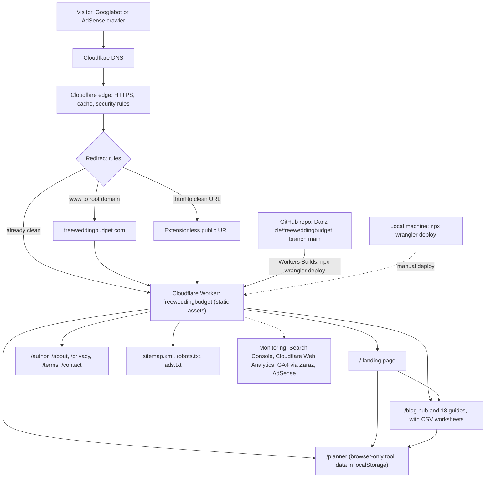

# Free Wedding Budget Planner

A free, no-account wedding budget planner that runs entirely in the browser, plus 18 budgeting guides that cite dated public sources and show their arithmetic.

**Live site:** https://freeweddingbudget.com
**Author:** Dan Liu ([about page](https://freeweddingbudget.com/author))

## What it does

**Planner** (`/planner`, vanilla JavaScript, no backend)

- Budget control center: set a total and category limits, record actual expenses, see what is left.
- Vendor true-cost comparator: enter package price, required fees, travel, rentals, overtime and tax for each quote, and compare the full cost instead of the headline price.
- Payment tracker: deposits, balances and due dates for each vendor.
- Guest count scenarios: save different guest counts and see how the catering estimate and headroom change.
- Display currency: 10 currencies (USD, EUR, GBP, AUD, CAD, NZD, SGD, MYR, TWD, HKD). It changes the display symbol only and does not convert amounts.
- Exports: Excel workbook, planning PDF, and vendor, payment and expense CSV files.
- Privacy: data stays in the browser (`localStorage`). A planner backup can be downloaded and restored, and the browser copy can be reset.

**Guides** (18 static pages under `/blog-*`)

- Each guide states its sources with links and the date they were read, and labels illustrative examples as fictional.
- Many guides ship a downloadable CSV worksheet with the inputs behind their tables.
- Topics include catering cost for 100 guests, what a 100-guest wedding costs according to The Knot and Zola, per-table vs per-guest pricing, courthouse wedding fees, and banquet pricing in Taiwan and Singapore.

## Tech

- Static HTML, CSS and vanilla JavaScript (`planner2.js`). No framework, no build step.
- SheetJS (`xlsx` 0.18.5, loaded from a CDN) for the Excel export; Lucide icons.
- Hosted on Cloudflare Workers static assets (`wrangler.toml`, assets directory `.`). `.assetsignore` keeps tests, notes and config files out of the public site.
- Tests use the Node.js built-in test runner (`node:test`), no dependencies.

## Hosting and traffic flow

The source lives on GitHub and is served by a Cloudflare Worker with static assets. Cloudflare sits in front of the domain and handles DNS, HTTPS, redirects, caching and security. There is no traditional origin server.

### Map chart



### Request flow

1. A visitor or crawler requests `freeweddingbudget.com` or `www.freeweddingbudget.com`.
2. Cloudflare DNS resolves the name to the Cloudflare edge.
3. Redirect rules normalise the URL: `www` goes to the root domain and `.html` goes to the clean extensionless URL (both checked on 22 Nov 2026).
4. The Worker named `freeweddingbudget` returns the requested HTML, CSS, JavaScript, image, CSV, `sitemap.xml`, `robots.txt` or `ads.txt` from its static assets.
5. The final public page carries a clean canonical URL such as `https://freeweddingbudget.com/blog-hidden-costs`.

### Deploy flow

- A merge to `main` on GitHub triggers Cloudflare Workers Builds, which runs `npx wrangler deploy`. Other branches build too, but do not go to production.
- A manual deploy from a local machine uses the same command.
- `.assetsignore` keeps tests, notes, Markdown files, `.wrangler` and config files out of the public site.

### Cloudflare DNS records (as last recorded)

| Hostname | Type | Target | Proxy status | Purpose |
|---|---|---|---|---|
| `freeweddingbudget.com` | Worker | `freeweddingbudget` | Proxied | Root site served by the Worker |
| `www.freeweddingbudget.com` | Worker | `freeweddingbudget` | Proxied | www hostname, redirected to the root domain |
| `freeweddingbudget.com` | TXT | `google-site-verification=...` | DNS only | Google site verification |

### Page roles

| Route | Role |
|---|---|
| `/` | Text landing page that introduces the site and links to the guides and the planner |
| `/blog`, `/blog-*` | Guide hub and 18 sourced guides |
| `/planner` | The planner tool, running entirely in the browser |
| `/author`, `/about`, `/privacy`, `/terms`, `/contact` | Author and site information |

### Troubleshooting order

1. GitHub source files, then the Workers Builds log
2. Cloudflare Worker deployment
3. Cloudflare DNS records and redirect rules
4. Live public URL response and canonical tag
5. `sitemap.xml`, `robots.txt`, `ads.txt`
6. Search Console and analytics status

## Run and test

```bash
# run the test suite (Node.js 18 or newer)
node --test tests/*.test.cjs

# preview locally with any static file server, for example
npx serve .

# deploy to Cloudflare Workers (needs a Cloudflare login)
npx wrangler deploy
```

The 71 tests cover three areas:

- `planner-regressions`: planner calculations, routing, exports and local navigation targets.
- `vendor-guide`: the vendor comparison guide and its worksheet.
- `practical-guides`: for each guide, the CSV worksheet is recomputed and compared with the figures printed on the page. The tests also check source link counts, minimum length, the blog hub, sitemap dates and the author page.

## Project layout

```text
index.html, planner.html   landing page and planner
planner2.js, planner2.css  planner logic and styles
blog.html, blog-*.html     guide hub and guides
*.csv                      downloadable worksheets used by the guides
author.html, about.html    author and site information
sitemap.xml, robots.txt, ads.txt
tests/                     node:test suites
wrangler.toml, .assetsignore
```

## Content approach

The guides use published figures only. Numbers come from public sources linked on each page, with the date they were read. Arithmetic done by the author is marked as such, examples that are not real quotes are labelled fictional, and nothing on the site presents invented prices, quotes or testimonials as real. This is general information, not financial or legal advice.

## License

No license has been chosen yet. All rights reserved by the author until one is added.
